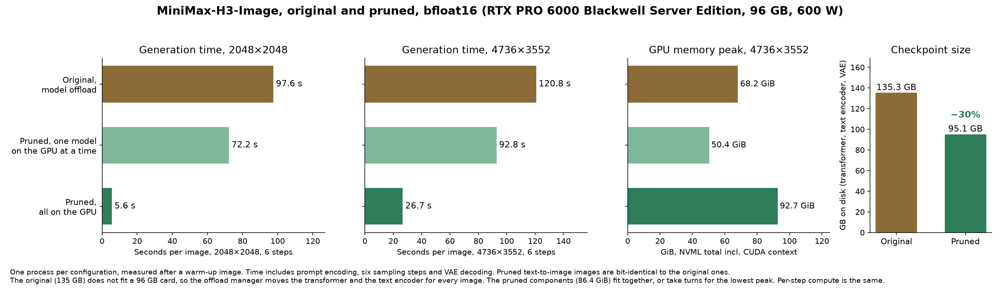

# MiniMax-H3-Image-Pruned

Build and verification scripts for [WaveCut/MiniMax-H3-Image-Pruned](https://huggingface.co/WaveCut/MiniMax-H3-Image-Pruned),
a smaller checkpoint of [MiniMaxAI/MiniMax-H3-Image](https://huggingface.co/MiniMaxAI/MiniMax-H3-Image). The stock
Diffusers and Transformers classes load it unchanged: no custom model code, no `trust_remote_code`, no package from
this repository.



| | Original | Pruned |
|---|---|---|
| Transformer | 66.3 GB | 40.2 GB |
| Text encoder | 66.7 GB | 52.5 GB |
| VAE | 2.3 GB | 2.3 GB |
| Time per 4736×3552 image, RTX PRO 6000 (96 GB) | 120.8 s (model offload, 68.2 GiB peak) | 26.7 s (all on the GPU, 92.7 GiB peak); 92.8 s (one model on the GPU at a time, 50.4 GiB peak) |
| Text-to-image results | | bit-identical |
| Edit results | | not bit-identical; PSNR 43.3 dB on the test edit |

The time difference comes from memory: the original does not fit a 96 GB card and the offload manager moves the
transformer and the text encoder for every image; the pruned models fit together. With one model on the GPU at a time
the pruned checkpoint also moves both models for every image, with 30 % less data and a 50.4 GiB peak. Per-step
compute is unchanged. All numbers come from one machine; see the
[model card](https://huggingface.co/WaveCut/MiniMax-H3-Image-Pruned#profiles) for 2048×2048 and edit times.

## What is removed

| Component | Change | Why it is possible |
|---|---|---|
| Transformer | `transformer_blocks.*.adaln_proj.linear` [96768, 2688] → [96768, 8], `norm_out.linear` [10752, 2688] → [10752, 8], `time_embedder` 5376 → 16 hidden units (13.0B parameters removed) | The input of these layers is the timestep alone, and the checkpoint samples on one fixed grid: six steps, plus t = 0.999 for the reference rows of an edit. Seven timesteps need seven input columns (eight, with one padding column). |
| Text encoder | Decoder layers 51-63 and `lm_head` (7.1B parameters, 14.2 GB) | The transformer is conditioned on `hidden_states[50]`, the output of layer 49 before the final norm. Layer 50 stays: the pipeline refuses a conditioner with 50 layers or fewer, and with 51 layers `hidden_states[50]` is still the output of layer 49. `lm_head` is tied to the input embedding, so loading allocates nothing for it. |

The VAE, tokenizer, processor and scheduler are the original files. Every kept tensor is a byte copy.

### How the transformer stays a stock model

The stock `MiniMaxH3ImageTransformer2DModel` takes `time_embed_dim` and `time_embed_hidden_dim` from its config.
The pruned config sets them to 8 and 16, and the weights are built so that the stock forward pass returns the
original modulation values:

* `time_embedder` maps each of the seven grid timesteps to a one-hot code. Its hidden layer has two hinge units per gap
  between neighbouring grid points of `sin(t)` (a `time_proj` feature); output k is 32 at t_k and below -300 at every
  other grid point. The stock AdaLN modules compute `silu(temb)` in float32 and cast it to bfloat16, which gives exactly
  `32 * e_k`: `silu(32)` is 32, and `silu(x)` is 0 below about -89 (the exponential overflows float32).
* Column k of each `adaln_proj.linear` and of `norm_out.linear` holds the original projection's output for t_k divided
  by 32 (exact in bfloat16), and the bias is zero. The product with `32 * e_k` has a single nonzero term, so the layer
  returns the stored row exactly, on any GPU and for any number of rows.

`prune.py` checks the codes with float32, TF32 and bfloat16 matmuls, checks that every stored column multiplied by 32
reproduces the original row, and compares the coded projections with the original ones for every timestep set the
pipeline uses.

### Text-to-image and edit

A matrix product can round differently with a different number of rows. The pipeline calls the original projections
with one timestep per text-to-image step and two (the step and 0.999) per edit step, so the original model itself
produces slightly different modulation values for the same step in the two modes. A stock time embedder sees each
timestep separately and cannot tell the modes apart, so the checkpoint stores one value per timestep: the
text-to-image one for the six steps, and the edit one for 0.999 (identical in all edit steps).

* Text-to-image: bit-identical to the original on the build GPU type.
* Edit: not bit-identical. 59,279 of the 29.1 million modulation values of the six step rows (0.20 %) differ from the original's two-row result by rounding steps. Through the 50 blocks this changes each edit step's transformer output by 2.1-2.5 % (relative L2), and the 2048×2048 test edit by PSNR 43.3 dB: mean absolute difference 0.63 of 255, 261 of 4.2 million pixels off by more than 64. In the worst region the differences follow edges; the two images look the same.

## Use

```bash
pip install "diffusers @ git+https://github.com/huggingface/diffusers@875373ac7f5856071e345a3e394c74efccc6b9e6" \
  "transformers>=5.22" accelerate torchvision
```

MiniMax-H3-Image support was merged into Diffusers after 0.41; until a release contains it, install Diffusers from
git as above. The pruned checkpoint loads like the original:

```python
import torch
from diffusers import ComponentsManager, ModularPipeline

manager = ComponentsManager()
manager.enable_auto_cpu_offload(device="cuda")  # or skip this and call pipe.to("cuda") on a GPU with 96 GB or more

pipe = ModularPipeline.from_pretrained("WaveCut/MiniMax-H3-Image-Pruned", components_manager=manager)
pipe.load_components(dtype=torch.bfloat16)

image = pipe(
    prompt=open("prompt.txt").read(),
    height=3552,
    width=4736,
    generator=torch.Generator().manual_seed(42),
    output="images",
)[0]
```

Edit: pass `image=reference` (or a list) and refer to the references as `<Picture 1>`, `<Picture 2>`, ... in the
prompt. `scripts/generate.py` wraps both and uses only Diffusers and Transformers.

### Memory modes

`enable_auto_cpu_offload` moves a model off the GPU only when the next one does not fit. On a 96 GB card the pruned
models fit together, so after the first image nothing moves and the run is as fast as with everything on the GPU
(peak 92.7 GiB). For the lowest peak, keep one model on the GPU at a time; set the strategy after loading, because
adding the components resets it to the default:

```python
pipe.load_components(dtype=torch.bfloat16)
manager.set_offload_strategy(lambda hooks, **kwargs: hooks)  # move every other model off the GPU first
```

The peak is then 50-52 GiB, set by the text encoder (48.9 GiB of weights), and each image moves both models over
PCIe: 72.2 s at 2048×2048 instead of 5.6 s on an RTX PRO 6000. The images are bit-identical to the all-on-GPU ones.
`scripts/generate.py --offload one-model` and `scripts/verify.py pruned --offload one-model` use this mode.

The components also load on their own with the stock classes:

```python
from diffusers import MiniMaxH3ImageTransformer2DModel
from transformers import Qwen3VLForConditionalGeneration

transformer = MiniMaxH3ImageTransformer2DModel.from_pretrained(
    "WaveCut/MiniMax-H3-Image-Pruned", subfolder="transformer", torch_dtype=torch.bfloat16
)
text_encoder = Qwen3VLForConditionalGeneration.from_pretrained(
    "WaveCut/MiniMax-H3-Image-Pruned", subfolder="text_encoder", dtype=torch.bfloat16
)
```

The truncated text encoder is a conditioner, not a usable language model.

## Build the checkpoint yourself

```bash
pip install "git+https://github.com/iamwavecut/MiniMax-H3-Image-Pruned"
minimax-h3-image-prune --output ./MiniMax-H3-Image-Pruned --device cuda
```

It downloads the needed files of `MiniMaxAI/MiniMax-H3-Image` (135 GB) unless `--source` names a local copy, copies
every kept tensor byte for byte, and computes the coded projections on `--device` with the original modules
(28 s for the projections on an RTX PRO 6000; the whole build took 110 s on a pod with fast local disk). `--skip text_encoder copies` builds only the transformer. `build_report.json` in the output's
`transformer/` lists, per timestep set, how many projection rows match the original exactly.

## Verify

```bash
python scripts/verify.py reference --source ./MiniMax-H3-Image --work ./verify
python scripts/verify.py pruned --source ./MiniMax-H3-Image --pruned ./MiniMax-H3-Image-Pruned --work ./verify
python scripts/verify.py compare --work ./verify
```

`reference` runs the official pipeline and records every transformer call; `pruned` loads the pruned checkpoint with
the same stock classes, runs the same prompts and seeds, and replays the recorded calls through the pruned transformer.
`compare` reports whether the text conditioning, the transformer outputs and the images are bit-identical, how far they
differ where they are not, and the time and GPU memory of each run.

## Limits

* Only the release's sampling grid. A timestep off the grid gives no valid code, and the stock model does not check
  for it: the output is wrong without an error. The original has one output head per step of this grid and cannot
  change it either.
* The stored values come from the build GPU (RTX PRO 6000 Blackwell). On another GPU type the original model can round
  its own projections differently by single bfloat16 steps; rebuild the transformer there
  (`minimax-h3-image-prune --skip text_encoder copies`) to match the original on that GPU.
* SGLang and ComfyUI load the original layout; they were not tested with this checkpoint.

## Previous format

The first release (Hub revision `3a804c0f`, package tag `v0.1.0`) stored the modulation as tables and needed
this package's model class and text-encoder adapter. It was bit-identical in edits too. The current format trades
that for loading with the stock classes.

## License

The scripts are Apache-2.0. The model weights are MiniMax-H3-Image Works under the
[MiniMax-H3-Image Community License](https://huggingface.co/MiniMaxAI/MiniMax-H3-Image/blob/main/LICENSE): use and
distribution are limited to the Applicable Territory, which excludes the European Union, the United Kingdom, the
Republic of Korea and the United States of America.
